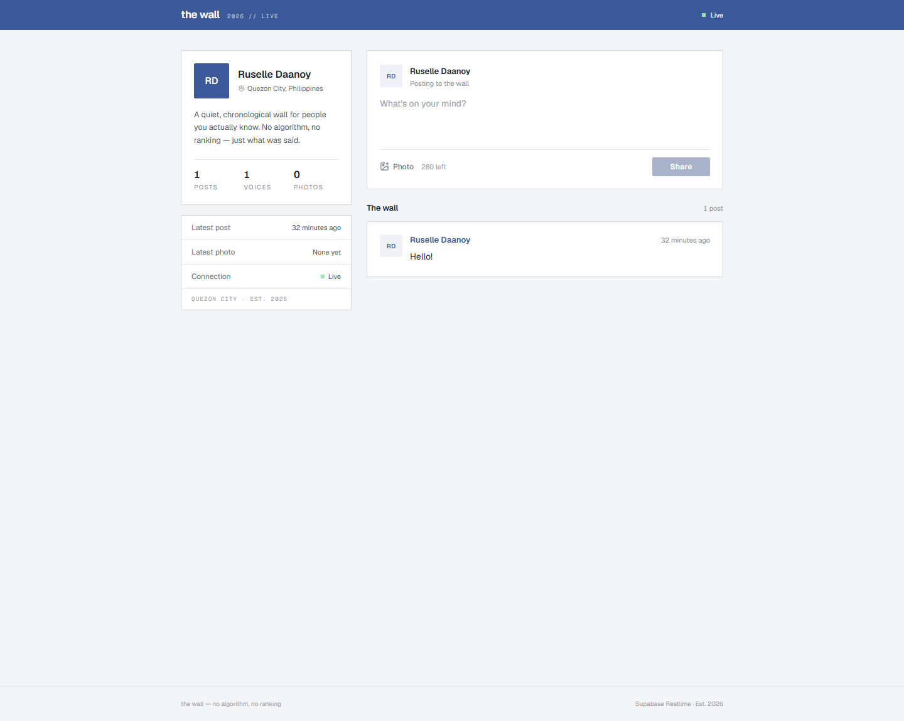
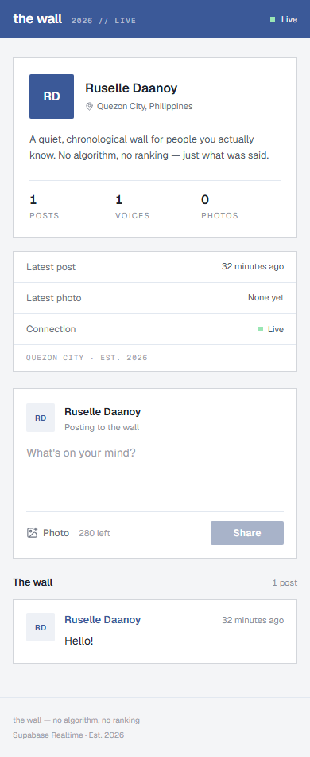

# the wall

A quiet, chronological social wall. Post a thought, attach a photo, and see it appear on everyone else's screen the instant it lands. No feed algorithm, no ranking, no engagement metrics — just the latest things the people you know wanted to say.

Built as a deliberate throwback to the 2008 Facebook Wall, redesigned with a clean, minimal interface for 2026.



<p align="center">
  
</p>

## What it is for

Most social feeds decide what you see for you. This one doesn't. `the wall` is a small, single-page app for a group of people who want one shared, reverse-chronological stream:

- **Write** up to 280 characters under your name.
- **Attach** one photo (JPG, PNG, GIF or WebP, up to 5 MB).
- **Watch** new posts from anyone else arrive live, without refreshing.
- **See** honest totals: how many posts exist, how many distinct voices are in the feed, and how many photos have been shared.

There are no likes, comments, notifications, or "suggested" content. Newest first, always.

## Screenshots

| Desktop | Mobile |
| --- | --- |
|  |  |

The stats in the sidebar are live, not decorative. **Posts** is an exact count from the database; **Voices** and **Photos** are derived from the current feed. **Latest post**, **Latest photo**, and **Connection** update as the wall changes.

## How it works

The client talks directly to Supabase — no custom backend.

1. `useWallFeed()` loads the 50 most recent rows from `public.posts` and subscribes to `postgres_changes` INSERT events on the same table.
2. The composer uploads an optional image to the public `wall-photos` Storage bucket, inserts the post row, and hands the returned row to the feed immediately.
3. Realtime echoes the same INSERT back; posts are merged and de-duplicated by `id`, sorted newest-first, and capped at 50. The total count is updated alongside.
4. If Storage isn't configured, the image upload is skipped and the text post still succeeds with a small notice. If Supabase env vars are missing, the page shows an offline state instead of crashing.

### Stack

| Layer | Choice |
| --- | --- |
| Framework | Next.js 16 (App Router), React 19, TypeScript |
| Styling | Tailwind CSS v4, custom cobalt/slate palette |
| Data & realtime | `@supabase/supabase-js` |
| Icons | `lucide-react` |
| Time formatting | `date-fns` |

### Project layout

```
app/
  layout.tsx        # Fonts, metadata, page shell
  page.tsx          # Header, profile, live stats, grid layout
  globals.css       # Tailwind entry and base colors
  icon.svg          # Tab icon
components/
  WallComposer.tsx  # Name, message, 280-char limit, photo upload
  WallFeed.tsx      # useWallFeed hook, realtime feed, post cards
lib/
  supabase.ts       # Typed Post model and Supabase client
docs/
  desktop.png       # Screenshots used above
  mobile.png
```

### Design

A thin cobalt header (`#3b5998`) sits over a light canvas (`#f4f5f7`). Cards use 1px `#d3d6db` borders, 2px corners at most, and no gradients or heavy shadows. Author names are cobalt, timestamps and metadata are quiet gray, and the layout is a 12-column grid on desktop that collapses to one column on mobile.

## Getting started

### 1. Install

```bash
npm install
```

### 2. Configure the environment

Create `.env` (or `.env.local`) with your Supabase project credentials:

```bash
NEXT_PUBLIC_SUPABASE_URL=https://your-project.supabase.co
NEXT_PUBLIC_SUPABASE_ANON_KEY=your-anon-key
```

### 3. Create the database table

```sql
create table public.posts (
  id uuid primary key default gen_random_uuid(),
  author_name text not null,
  message text not null,
  image_url text,
  created_at timestamptz not null default now()
);

alter table public.posts enable row level security;

create policy "Posts are publicly readable"
  on public.posts for select using (true);

create policy "Anyone can post"
  on public.posts for insert with check (true);

-- Enable Realtime for the wall
alter publication supabase_realtime add table public.posts;
```

### 4. Create the photo bucket (optional)

In Supabase Storage, create a **public** bucket named `wall-photos`. Uploads go to `YYYY-MM-DD/<uuid>.<ext>` and are served from the bucket's public URL. Without this bucket the app still works — posts are simply text-only.

### 5. Run it

```bash
npm run dev
```

Open [http://localhost:3000](http://localhost:3000).

## Scripts

| Command | Purpose |
| --- | --- |
| `npm run dev` | Start the development server |
| `npm run build` | Production build |
| `npm run start` | Serve the production build |
| `npm run lint` | Run ESLint |

## Notes and limits

- The feed loads the latest **50 posts**; older posts remain in the database but are not rendered.
- **Voices** and **Photos** are counts within the loaded feed, while **Posts** is the exact table count.
- There is no authentication: anyone with the anon key can read and insert. That is intentional for a small private wall, but it is not suitable for sensitive content.
- Deleting and editing posts are not implemented yet.
